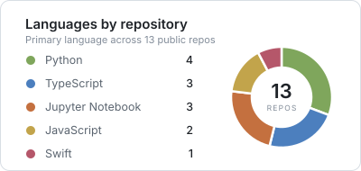
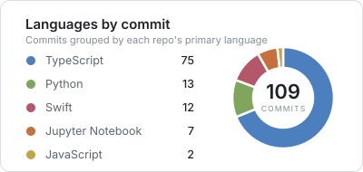

<picture>
  <source media="(prefers-color-scheme: dark)" srcset="./assets/header-dark.svg" />
  
</picture>

I build machine learning systems that end up in front of people — the model, the service
around it, and the interface that makes it useful. Most of what's here started as a question
I wanted answered and turned into something that runs.

Currently working on predictive maintenance for military UAVs and ground vehicles.

### Selected work

**[uav-pdm-dashboard](https://github.com/mandalswarnim/uav-pdm-dashboard)** · [Live](https://swarnimmandal.me/uav)  
ARES PdM — a predictive-maintenance digital twin for UAVs and missiles. LSTM, Transformer and
CNN models in PyTorch, trained on NASA C-MAPSS plus synthesized multirotor logs, with FastAPI
live inference feeding a Next.js HUD (armory, mission, diagnostics, model lab).

**[ai-receptionist](https://github.com/mandalswarnim/ai-receptionist)** · [Live](https://swarnimmandal.me/ai-receptionist)  
A phone receptionist that answers, understands and follows up — Twilio, GPT-4o and SendGrid.
Now multi-business: per-business prompts and call routing, a demo builder, Google Sheets
sales-pipeline sync and a calling cockpit.

**[CRM](https://github.com/mandalswarnim/CRM)**  
Meridian — a multi-tenant, metadata-driven CRM modeled on Salesforce. Real SOQL/SOSL parser,
Salesforce-shape REST/Bulk/SOAP APIs, Flow, approval processes, a scheduler and a booking
engine, shipped with a sample private members' club org.

**[Airfoil-Selector-for-Wind-Turbines](https://github.com/mandalswarnim/Airfoil-Selector-for-Wind-Turbines)**  
Ranks airfoils for small wind turbines by annual energy production under a site's real wind,
and explains why the winner wins.

**[mobile-decentralized-voting](https://github.com/mandalswarnim/mobile-decentralized-voting)**  
Decentralized voting on Ethereum — Solidity contracts behind an Express and React app.

**[Portfolio](https://github.com/mandalswarnim/Portfolio)** · [Live](https://swarnimmandal.me)  
My portfolio site — Next.js 16, React 19, Tailwind and Framer Motion, with a cinematic ASCII
hero portrait and colour-chapter design.

### Working with

Python · TypeScript · JavaScript · Solidity  
PyTorch · TensorFlow · Hugging Face · Jupyter  
Next.js · React · FastAPI · Django · Node  
PostgreSQL · Twilio · OpenAI API  
Docker · Kubernetes · Git · Vercel

### What I've been writing

  <picture>
    <source media="(prefers-color-scheme: dark)" srcset="./assets/languages-by-repo-dark.svg" />
    
  </picture>
  <picture>
    <source media="(prefers-color-scheme: dark)" srcset="./assets/languages-by-commit-dark.svg" />
    
  </picture>

<picture>
  <source media="(prefers-color-scheme: dark)" srcset="https://raw.githubusercontent.com/mandalswarnim/mandalswarnim/output/github-contribution-grid-snake-dark.svg" />
  
</picture>

### Elsewhere

[Portfolio](https://swarnimmandal.me) · [LinkedIn](https://www.linkedin.com/in/swarnim-mandal-678976259/) · [Email](mailto:mswarnim1@gmail.com)

Off the clock: rock riffs, guitar strings, and building things that probably shouldn't work — but do.
